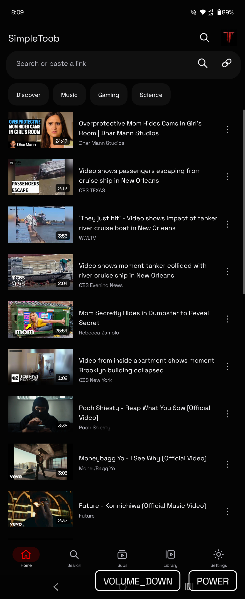
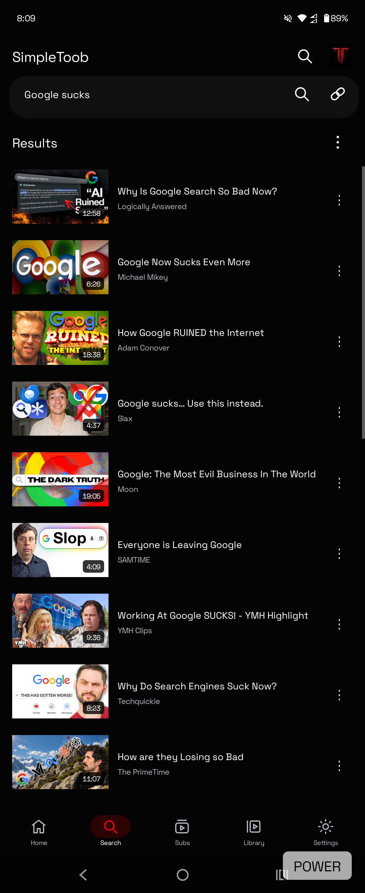
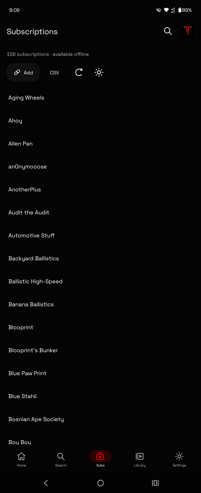
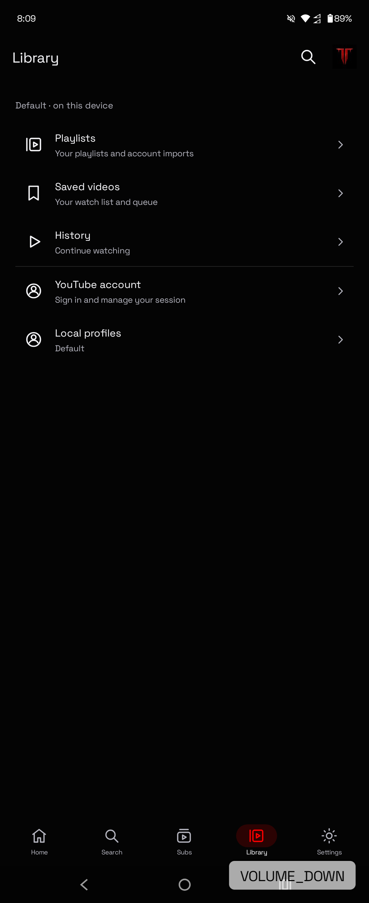
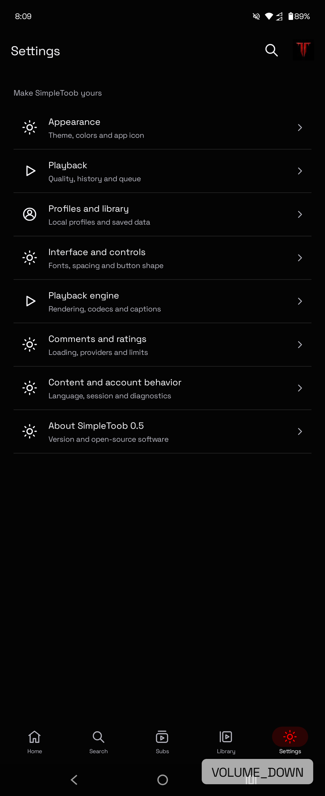
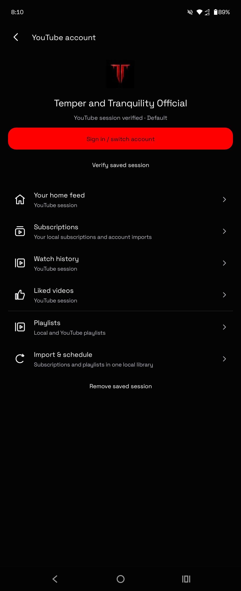

# SimpleToob

## Version 0.9.0 — Creature Comforts

I built SimpleToob for people who want to watch YouTube without surrendering the interface to a marketing department.

It is an independent Android client with native video playback, local subscriptions, local playlists, resumable downloads, comments, optional account integration, and enough appearance controls to stop somebody else’s design committee from choosing everything for you.

The application code is Java. Heavy work runs on separate background workers. The icon is a deliberately questionable crayon play button. Corporate branding departments can cope.

**SimpleToob works without a Google or YouTube account.** Local subscriptions, playlists, Saved videos, history, public subscription notifications, and supported downloads remain available without signing in.

The official YouTube app is not required. Normal use does not require your own API key or a Google developer project.

| Requirement | Version |
| --- | --- |
| Minimum Android version | Android 8.0 Oreo, API 26 |
| Current application version | 0.9.0 |
| Application source | Java 17 |
| Compile and target SDK | Android API 36 |

## What is new in 0.9.0

- **SponsorBlock:** optional sponsor-segment skipping in video and audio playback, with an undo action.
- **Resumable downloads:** a persistent per-profile queue that retains verified partial files and refreshes expired stream links when retrying.
- **Subscription notifications:** optional background checks for public uploads from your subscriptions, without requiring sign-in.
- **Video chapters:** native chapter selection in both the video player and Audio.
- **Playlist downloads:** queue local, imported, or supported remote playlists into a folder chosen through Android’s file picker.

The application remains Java, and this revision adds no runtime dependencies. It also strengthens lifecycle cancellation, stale-result checks, connection cleanup, and ownership of background resources.

SponsorBlock and subscription notifications are **off by default**.

## Who it is for

SimpleToob is for people who want:

- A useful YouTube client without an account.
- Subscriptions and playlists stored on their own device.
- Optional access to an existing YouTube account.
- Native video playback and background audio.
- Downloads they can pause and resume.
- Control over colors, darkness, fonts, spacing, buttons, and playback behavior.
- Readable comments and useful video details.
- A conventional video interface without being dumped into a Shorts feed.
- An app built for watching, rather than another mobile upload dashboard.

Uploads are deliberately omitted.

## Features

### Account-free watching and local collections

Without signing in, you can:

- Search for public videos.
- Open supported video, Shorts, and live links.
- Open video IDs or paste supported embed codes.
- Browse channels and public playlists.
- Play supported public video streams.
- Read public comments and replies.
- View available likes and estimated dislikes.
- Save video references locally.
- Keep local watch history and resume positions.
- Subscribe to channels locally and browse their videos.
- Enable public subscription notifications.
- Create, rename, reorder, and delete local playlists.
- Play local playlist queues.
- Import a subscription CSV.
- Download supported MP4 videos and playlists.
- Use SponsorBlock and available video chapters.
- Use the appearance and playback settings.

Your local lists remain available when you sign out.

Saved videos and local playlists contain references and metadata. Saving a video to your library does not download its media. Streaming requires a connection; downloading saves the actual video file.

### Home and discovery

Home contains two choices:

- **Popular now:** public regional charts for Music, Gaming, and Trailers.
- **For you:** native recommendations from the selected signed-in YouTube account.

Popular now works without an account. For you requires a working saved account session.

Home remembers its mode and chart selection for each local profile. Available controls include region selection, refresh, and pagination.

The configurable discovery query remains available through **Search topic**. Popular now uses category charts rather than presenting a search for “new videos” as a trending feed.

On wider Home windows, cards can use two columns from 700 dp and three columns from 1050 dp. Compact cards retain a list. The grid can be disabled under:

**Settings → Interface and controls → Home grid on wide screens**

Account recommendations come from YouTube. SimpleToob does not upload its local watch-history database to train those recommendations.

### Native video playback

Playback uses a native Media3 player with:

- Quality selection from available streams.
- Combined and separate audio/video streams.
- MP4, WebM, and supported extracted HLS playback.
- Playback-speed controls.
- Configurable seeking.
- Captions when available.
- Fullscreen playback.
- Local resume checkpoints.
- Video chapters when supplied.
- Optional SponsorBlock skipping.
- Optional looping.
- Optional automatic advancement through a queue.
- Decoder and format fallbacks.
- Configurable rendering surface and codec preferences.
- Visible loading and playback errors.
- Retry that refreshes extracted stream links.

SimpleToob does not include a YouTube ad player, an advertising SDK, or an automatic fallback to an ad-supported embedded player.

Leaving the regular video player or locking the phone pauses video playback. Audio playback has its own background service.

### Background audio

The Audio player can play Saved videos or local and imported playlists without an account.

It supports:

- Public audio-only streams.
- Playback while the screen is off or another app is open.
- Media notification and lock-screen controls.
- Previous and next track.
- Seeking.
- Shuffle.
- Repeat track or queue.
- Retry after a playback error.
- A sleep timer.
- Available audio-track selection.
- Available chapters.
- Optional SponsorBlock skipping.

Use **Listen** on a watch page to open that video in Audio, or use **Audio** inside a local playlist.

The audio queue is held while the service lives. It is not automatically restored after a reboot or process death. Android or manufacturer battery restrictions can interrupt background playback.

### Original audio and alternate tracks

Audio selection prefers tracks marked as original before comparing bitrate. If original-role metadata is absent, unlabelled tracks are preferred over explicitly dubbed tracks.

The app does not force English. A video originally recorded in German should retain its original German soundtrack when the extractor supplies usable metadata.

Use **Audio track** on the watch page or in Audio options to choose an available original, dubbed, descriptive, or alternate track.

Switching tracks preserves the playback position and playing/paused state where supported. Explicit per-video choices normally last for the current process; download jobs retain their saved choice for later resumption.

If YouTube does not expose enough track metadata, SimpleToob cannot reliably identify the original soundtrack. Some combined or HLS sources also limit independent track selection.

### SponsorBlock

SponsorBlock is available under:

**Settings → Playback → SponsorBlock**

It starts disabled. When enabled, it skips available segments in SponsorBlock’s **sponsor** category during video and audio playback.

Use **Undo sponsor skip** in the watch action row or Audio options to return to the skipped interval and replay it.

Lookups send the first four hexadecimal characters of a hash of the video ID. Matching happens locally against the returned full hash. Requests do not include the saved YouTube account session, segment votes, submissions, or viewed-segment reports.

SponsorBlock still receives ordinary connection information, including the requesting IP address. Hash-prefix lookup should not be read as a promise of anonymity.

If the lookup fails or no suitable segments are available, playback continues normally.

This revision supports sponsor skipping. Other SponsorBlock categories and segment submission are not included. Skipping changes playback position; it does not remove content from downloaded MP4 files.

### Video chapters

When the extractor supplies chapter metadata, **Chapters** displays chapter names and timestamps in chronological order.

Selecting a chapter seeks within the current video or audio track.

Chapter controls are available in:

- The watch page’s horizontal action row.
- Audio options.

Missing chapter information produces a short message. SimpleToob does not invent chapter titles or automatically generate chapters.

### Comments and ratings

Existing public comments load independently of whether the video plays or an account is signed in.

The native comments panel supports:

- Comments and replies.
- Refresh.
- Additional pages.
- Configurable automatic loading.
- A configurable maximum number of loaded comments.
- Comment composition with local draft preservation.

Posting requires a working signed-in session. A draft is retained when submission is not confirmed. YouTube’s moderation and visibility rules still apply.

Likes prefer available YouTube-reported metadata. Dislikes can come from Return YouTube Dislike, with an optional additional Invidious source.

Dislike figures are labeled estimates. Sources may share underlying data, so the app does not add overlapping estimates together.

Video cards, watch pages, and playlist/account video lists can also show view counts and upload dates when supplied. Missing values stay absent, and relative website dates are not presented as precise timestamps.

### Optional account integration

Signing in adds account features without replacing the local library.

Implemented account paths include:

- Account verification and profile pictures.
- Native Home recommendations.
- Account subscription, history, and liked-video feed access.
- Likes, dislikes, and clearing a reaction.
- Comment submission.
- Subscription actions.
- Playlist creation and adding videos.
- Importing subscriptions and playlists into the regular local collections.

The account window displays Google and YouTube’s own pages inside SimpleToob. After authorization reaches a signed-in YouTube page, the app presents native account handoff controls.

**Use this account** verifies the candidate session before replacing the saved account. A failed verification preserves the previous saved session.

**Choose another account** and the account-window channel-selection options allow further selection inside the app.

Being signed into Android does not automatically authorize SimpleToob. The app retains its own YouTube session.

Account integration uses website-session requests rather than a registered Google OAuth client or a personal YouTube Data API key. Google may reject embedded sign-in, and YouTube can change or decline these requests.

### Subscription and playlist imports

Imports copy account collections into the same local lists used elsewhere in SimpleToob.

Subscriptions and playlists each have independent controls for:

- Manual import.
- Import on app launch.
- Automatic intervals.
- Preset or custom intervals from 15 minutes to seven days.

Scheduled and launch-time importing start disabled.

A separate **Refresh imports after account switching** preference is enabled by default. It requests a one-time refresh after selecting a different YouTube account/channel or returning to another signed-in local profile.

Automatic imports pause while signed out. Changing accounts or local profiles stops work associated with the previous session. Account-access rejection can also pause automatic imports until the session is recovered.

Android controls when background jobs actually execute, so intervals are approximate.

Two import behaviors are available:

- **Merge:** keeps channels and playlists that disappear from later account results.
- **Mirror:** removes missing previously imported collections for the selected account while protecting local-only items and locally edited playlists.

Unedited imported playlists refresh their contents from YouTube. Locally edited copies are protected until **Allow refresh from YouTube** is explicitly selected.

While signed in, collection views normally show local items plus imports belonging to the selected account. **Show all account imports** restores the combined view. Signing out makes saved imports available locally without synchronizing them.

Imports do not automatically upload local edits.

### Subscription notifications

Subscription notifications are available under:

**Settings → Profiles and library → Subscription notifications**

They start disabled and work without signing in.

When enabled, the app requests an approximately hourly background check of public uploads from the active profile’s visible subscription collection. Android notification permission is requested where required.

The first successful nonempty check for each channel establishes a silent baseline. Later checks can notify about newly encountered uploads ahead of the first known video in that channel’s current results.

Checks are deliberately bounded:

- Up to ten channels are checked per run, in rotation.
- Large subscription lists take multiple runs to cover.
- Active audio or video playback defers a run.
- Recent video IDs are retained to suppress repeat notifications.
- Failed requests preserve the previous successful snapshot.

Notifications open **Subs**.

This is periodic polling, not instant push delivery. Android scheduling, battery policy, connectivity, and channel-list size affect timing. Uploads that disappear from the first results page between checks can be missed.

Checks use the public videos tab. They are not a complete Shorts or live-release monitor, and they do not automatically download new uploads.

### Resumable downloads

Supported MP4 sources can be downloaded to a location chosen through Android’s file picker.

Downloads provide:

- A persistent queue separated by local profile.
- Progress, transferred amount, and transfer-rate reporting.
- Pause and explicit resume.
- Retry of failed entries.
- Retention of verified partial files.
- Refreshed stream links on later attempts.
- Separate audio/video track downloading and MP4 joining.
- Continued downloading after leaving the player.
- Optional unmetered-network restrictions.
- Opening completed files from the download list.

Manage the queue under:

**Settings → Profiles and library → Downloads**

One queued video is processed at a time. Its tracks can use the configured bounded download connections.

Only complete, verified chunks are eligible for reuse. Resumption also requires a matching media version, size, and format identity. If the server cannot establish that the media is unchanged, the affected track restarts.

Servers without usable byte-range support restart their whole track. Joining tracks and copying the final file may also repeat after an interruption.

Interrupted running jobs become paused when recovered. Downloads do not automatically restart at boot.

**Pause** retains verified parts. **Cancel** removes private partial files and attempts to remove the incomplete destination document. Removing a completed entry from the queue keeps the completed file.

The chosen document provider must continue granting access to the destination. Revoked permissions or provider failures can require canceling the job and choosing a destination again.

WebM and HLS downloads are not supported in this revision.

### Playlist downloads

Open a local, imported, or supported remote playlist and choose **Download playlist**.

Choose a destination folder once. The app snapshots the local contents or reads the remote playlist’s continuation pages before adding individual MP4 jobs to the queue.

Playlist downloads:

- Use the same persistent queue as individual downloads.
- Continue when an individual video fails.
- Allow failed entries to be retried separately.
- Preserve completed files.
- Follow the available MP4 formats and preferred quality.
- Require no account for public playlists and public media.

The queue holds at most **500 entries per local profile**, including completed entries. Removing finished entries makes room for more. Remote playlist reads also have a 100-page safety limit.

If the playlist exceeds the limits, it is not silently presented as a complete download request.

An imported or account playlist can contain videos that public extraction cannot download. Account access to playlist metadata does not add support for paid, private, DRM-protected, or otherwise unavailable media.

### Customization and languages

The interface includes:

- English.
- Simplified Chinese.
- Hindi.
- Spanish.
- Arabic.
- French.
- Bengali.

Interface translations are bundled with the app. No translation service is contacted.

The first launch selects a supported language from the device’s ordered preferences, falling back to English. A manual choice or **Use device language** is available under:

**Settings → Appearance → Interface language**

Arabic includes right-to-left layout support.

Interface language is separate from content language, region, captions, and audio-track selection. Video titles, chapter names, channel names, playlist names, and comments retain their supplied language.

Appearance controls include:

- System, light, and dark themes.
- Dark-background brightness, including black.
- Neutral, warm, and cool gray tones.
- Preset and custom RGB accent colors.
- Square or rounded buttons.
- Rounded-button radius.
- Font family and app text size.
- Panel padding.
- Standard or compact video cards.
- Channel-name, duration, view-count, and upload-date visibility.
- Home grids on wider windows.
- Crayon, blue-crayon, and monochrome launcher icons.

Playback and behavior controls include:

- Preferred maximum quality.
- Starting playback speed.
- Autoplay when opening a video.
- Queue advancement.
- Resume positions and history recording.
- Looping and keeping the screen awake.
- Seek-button interval.
- Video fit.
- Caption preferences, language, and size.
- Rendering surface and codec preferences.
- Decoder and format fallback.
- Progressive CDN chunking.
- Buffer budgets.
- Download connection count.
- SponsorBlock.
- Subscription notifications.
- Startup screen.
- Home discovery topic.
- Content language and region.
- Short-video filtering.
- Hidden-channel filters.
- Comment loading and limits.
- Rating providers.
- Local, YouTube, or combined subscription actions.
- Download and import network restrictions.
- Account-import schedules and behavior.

The interface belongs on your phone. It should not require permission from a product manager to change its accent color.

## Getting started

### Install or update

Install on Android 8.0 or newer from the Releases section.

The supplied 0.9.0 debug APK uses the same development signing identity as the supplied 0.8.1 build. Android updates require matching application identity and signing certificates.

### Search and open videos

Use the search field and search button.

The link button accepts supported YouTube URLs, video IDs, and embed codes. Embed markup is parsed for its video URL; it is not executed.

You can also share a supported video link to SimpleToob through Android’s share menu.

Use **Popular now** for public regional charts. Select **For you** for the signed-in account’s Home recommendations.

### Use the video player

Tap the video to show or hide its controls.

The on-video controls provide play/pause, seeking, and fullscreen. The player-options menu contains quality, speed, captions, retry, and stream details.

The action row scrolls horizontally. Download, Playlist, Audio track, Chapters, and other actions may be off to the side.

Leaving the video player pauses playback. Use **Listen** or the **Audio** tab for background audio.

### Use chapters and SponsorBlock

Choose **Chapters** on the watch page or in Audio options.

Enable optional sponsor skipping under:

**Settings → Playback → SponsorBlock**

After a skip, **Undo sponsor skip** returns to the skipped interval.

### Save videos and use history

**Save** adds a video reference to your local Saved list.

Library contains Saved videos, history, and playlists. Saved supports sorting and queue playback.

History recording and resume behavior can be disabled in Settings.

### Add local subscriptions

Open **Subs** and choose **Add**, or subscribe from a video.

Local subscriptions need no Google account. Tap a channel to browse its videos.

Holding a subscription offers local removal. This does not unsubscribe on YouTube. A later account import can restore the entry if you remain subscribed there.

### Enable subscription notifications

Open:

**Settings → Profiles and library → Subscription notifications**

Enable the feature and grant notification permission if requested.

The first successful checks establish a quiet baseline. Later checks can notify about new public uploads. Timing is approximate and larger subscription collections take multiple runs to cover.

### Import a subscription CSV

Use **CSV** in Subs and select an extracted Google Takeout `subscriptions.csv` file.

Extract the CSV from the Takeout ZIP first. The app imports the CSV itself.

### Create and manage playlists

Open Playlists through Library or Account.

**Create playlist** creates a local playlist. When signed in, it also offers creation on YouTube.

Use the player’s **Playlist** action to add a video. Matching imported playlists can offer a local-only addition or an explicit addition to YouTube and the local copy.

Hold a playlist to rename or delete it. Imported playlists also provide **Allow refresh from YouTube**.

Inside a local playlist, hold a video for move-up, move-down, or removal options.

**Play queue** starts video playback. Automatic advancement is controlled separately in Settings. **Audio** opens the playlist in the background audio player.

### Download a video

Choose an available MP4 quality, then use **Download**.

Select the destination through Android’s file picker. Notification permission allows visible notification controls where Android supports them.

Open **Settings → Profiles and library → Downloads** to manage the queue.

### Download a playlist

Open the playlist and choose **Download playlist**, then choose a folder.

For a remote playlist, the app reads its pages before adding the snapshot to the queue. Each video becomes a separate MP4 job.

Individual failures do not stop the remaining queued videos. Queue and playlist-size limits still apply.

### Pause, resume, or remove a download

Open **Downloads** and select an entry.

- **Resume** retries a paused or failed job, reusing verified data where safe.
- **Pause** retains partial files.
- **Cancel download** removes partial files and attempts to delete the incomplete destination.
- **Remove from list** removes the entry; completed files are kept.
- **Open file** opens a completed download through an available Android app.

The download notification’s **Pause** action pauses queued work as well as the current transfer.

### Read or write comments

Tap the Comments preview beneath a video.

The panel provides comments, replies, refresh, additional pages, and composition. Existing public comments work without signing in.

Posting requires a working account session. Drafts remain local until submission is confirmed.

### Sign in, if you want to

Open the account icon and choose sign-in.

Complete account selection inside the in-app account window. After the native handoff appears, use **Use this account** to verify and save the intended session.

Use **Choose another account** or the account-window channel-selection option when needed.

Verification errors appear in a dismissible dialog. A failed candidate verification preserves the previous saved session.

The account-window menu also includes text size, rendering mode, display information, and session removal.

### Configure account imports

Open **Import & schedule** from Subs, Playlists, or Account.

The same controls are available under:

**Settings → Profiles and library → Account imports**

Subscriptions and playlists have independent manual, launch-time, and interval controls.

Merge keeps missing imported collections locally. Mirror can remove missing previously imported collections for the selected account while protecting local-only items and locally edited playlists.

Local edits are not automatically uploaded.

### Change appearance and behavior

Open Settings and select the relevant category.

- **Appearance:** themes, colors, icons, and interface language.
- **Interface and controls:** fonts, spacing, card details, button shape, and Home grids.
- **Playback:** viewing preferences and SponsorBlock.
- **Playback engine:** rendering, codecs, buffers, and transfer controls.
- **Profiles and library:** profiles, collections, imports, Downloads, and subscription notifications.

## Storage and privacy

Saved videos, history, subscriptions, playlists, and download queues are kept in app-private local storage, separated by local profile.

Paused and failed downloads can retain media parts in private storage until completed or removed. Completed downloads are written to the destination chosen through Android’s document picker.

Saved native YouTube session snapshots are encrypted using Android Keystore. The account window also retains app-private browser cookies and page storage to preserve sign-in progress.

Removing the saved session clears its native session and account-window cookies. Local collections remain available.

Android backup is disabled. App-private collections, sessions, notification baselines, and download-resume state should not be expected to survive uninstalling the app or clearing its data.

I have not added a SimpleToob analytics SDK.

Network requests still reach the services needed for enabled features:

| Service or feature | Information involved |
| --- | --- |
| YouTube extraction and streaming | Requests needed to retrieve public metadata and media |
| Signed-in account features | Requests using the explicitly saved YouTube session |
| Enabled rating providers | Video IDs and ordinary connection information |
| Public image hosts | Thumbnail and avatar requests |
| Enabled SponsorBlock | A four-character video-hash prefix and ordinary connection information |
| Enabled subscription notifications | Public channel-upload checks |

SimpleToob does not upload its local watch-history database to train recommendations. SponsorBlock lookups do not send saved account cookies or viewed-segment reports.

Diagnostics exclude passwords, saved session cookies, comment contents, and full stream URLs.

## Resource usage and lifecycle handling

Expensive network, parsing, media preparation, image, import, and database work runs away from Android’s UI thread.

The app uses bounded worker pools and queues. Rejected work reports a busy state rather than running expensive operations on the UI thread.

The 0.9.0 changes add or strengthen:

- Cancellation of Activity-owned background work on destruction.
- Removal of pending UI callbacks and pruning of completed tasks.
- Generation checks that reject stale playback and SponsorBlock results.
- Disconnection of replaced or canceled SponsorBlock requests.
- Cleanup of audio and download callbacks when their owners stop.
- Closure of transfer connections and file streams.
- Joining of transfer workers before partial files are removed or reused.
- Serialized download commands and service-instance handoff.
- Release of download wake locks.
- Closure or release of SQLite helpers, cursors, media extractors, and muxers.
- A shared bounded sample buffer for the two tracks during muxing.

These are resource-ownership safeguards. Device heap profiling has not yet established that the entire application is free of memory leaks.

## Beta limits and troubleshooting

YouTube changes its website and request formats. Extraction, account features, or particular sources can break and require a client update.

- **A video will not play:** retry to refresh its links, try another available format, or use the bundled offline renderer test to help distinguish rendering trouble from network/extraction trouble.
- **An audio track sounds wrong:** use Audio track when alternate tracks are exposed. Original-track identification depends on supplied metadata.
- **Sign-in is rejected:** Google may decline embedded sign-in. A successful website login does not guarantee every native account request will be accepted.
- **For you is unavailable:** it requires a usable selected-account session. Popular now and local collections remain available without one.
- **A download restarts:** its server may lack usable ranges or the app may be unable to verify the same media version. Reusing uncertain bytes would risk a damaged file.
- **A download cannot save:** the document provider may have revoked access, the destination may be unavailable, or temporary storage may be insufficient.
- **An incomplete file is visible:** a final destination copy can be interrupted. Resuming rewrites it; canceling attempts to remove it.
- **A playlist is rejected:** the queue allows up to 500 entries per profile, including completed entries, and remote reads have a page limit.
- **A notification is late or absent:** checks are periodic, bounded, and subject to Android scheduling, playback deferral, notification permission, and system notification settings.
- **A chapter or sponsor skip is missing:** the relevant metadata may not exist or the provider may be unavailable.
- **Background audio or downloads stop:** Android service limits and manufacturer battery restrictions can interrupt background work.

Public extraction does not add access to private, paid, DRM-protected, age-restricted, or otherwise unavailable media.

## Screenshots

Screenshots illustrate the interface; appearance depends on settings, device size, and app version.

## Complete changelog

Entries describe the behavior introduced in each release. Current feature descriptions above supersede older limitations and policies.

### 0.9.0 — Creature Comforts

Added:

- Optional SponsorBlock sponsor skipping in video and audio playback.
- Undo sponsor skip in the watch action row and Audio options.
- Hash-prefix SponsorBlock lookups without saved account cookies, votes, submissions, or viewed-segment reports.
- Persistent per-profile MP4 download queues.
- Pause, explicit resume, retry, cancellation, removal, and opening completed files.
- Verified partial-file retention and atomic chunk checkpoints.
- Fresh extraction of expiring media links on later attempts.
- Media-version, size, and format checks before reusing partial data.
- Safe track restart when a matching representation cannot be established.
- Optional public subscription notifications without an account.
- Silent initial notification baselines, bounded rotating checks, and duplicate suppression.
- Native video/audio chapter selection.
- Local, imported, and supported remote playlist download snapshots.
- A folder picker for playlist downloads.
- A 500-entry queue limit per profile and a bounded remote-page read.
- Independent failure handling for individual playlist videos.
- Thirty-three new interface phrases in the existing seven languages, bringing the catalogue to 668 entries per language.
- Feature-policy and real HTTP resumption regression checks.
- Download-recovery SQLite checks and an Android download-store test.

Changed and strengthened:

- Track Activity-owned work and cancel it on destruction.
- Remove pending result callbacks and prune finished tasks.
- Close replaced or canceled SponsorBlock requests and reject stale results.
- Serialize download commands and service-instance handoff.
- Keep queued jobs from starting ahead of pending pause/cancel controls.
- Retain interrupted jobs as paused work.
- Stop further previous-profile transfers after a profile change.
- Release sockets, streams, workers, wake locks, database helpers, extractors, and muxers.
- Share one bounded sample buffer between muxed tracks.
- Keep download-job metadata free of expiring stream URLs.
- Preserve Java, native UI, optional sign-in, the Android 8.0 minimum, existing runtime dependencies, and the development signer.

Validation:

- 4,882 Java host assertions.
- 30 SQLite checks.
- 4,676 language-resource entries checked.
- Application compilation, DEX generation, signing, and alignment passed.
- Device testing, Android instrumentation execution, Gradle/Lint, and heap profiling remain pending.

### 0.8.1 — Account-switch/import fixes and video details

Fixed and changed:

- Stop the YouTube website at a signed-in landing and hand off to native Account ready / Use this account controls.
- Keep candidate selection in memory until verification.
- Enforce a redirect-chain limit alongside the fast-loop timer.
- Prevent inherited gesture flags from resetting redirect budgets; actual user interaction and explicit retries can reset them.
- Verify candidate sessions before replacing the saved account.
- Commit encrypted cookies, selected account/channel, and verified identity together with profile/revision checks.
- Reject mismatched explicit page/account contexts and comparable selected-channel tokens.
- Avoid assuming account zero when selection metadata is absent.
- Use selected-account authenticated browse requests for initial and continuation subscription/playlist pages.
- Refuse signed-out or unrecognized collection responses without treating them as empty remote collections.
- Scope signed-in collection views and playlist choosers to local items plus the selected account’s imports.
- Preserve stored collections and the signed-out combined view.
- Refresh subscription results as soon as their transaction commits, independently of slower playlist imports.
- Show import progress on Subs.
- Rebind playlist views to the current local profile after a profile change.
- Preserve Home recommendations, original-audio policy, background Audio, worker pools, schema 4, Android 8.0 support, and the development signer.

Added:

- Choose another account on the native handoff.
- Choose a YouTube channel in account-window options.
- Show all account imports.
- Refresh imports after account switching, enabled by default.
- View counts and upload dates on cards, watch pages, playlists, and account video lists.
- Independent view-count and upload-date display toggles.
- Backward-compatible metadata fields.
- Reuse of extracted numbers, exact dates, and supplied website text without per-card fetches or invented timestamps.
- Sixteen interface/error phrases across seven languages, reaching 635 entries per language.
- Slow-loop, handoff-selection, account/channel mismatch, collection-request, metadata, and SQL account-scope checks.
- Android session-vault and account-view test coverage.

### 0.8.0 — Recommendations and regional Home charts

Added:

- Popular now and For you inside the existing Home screen.
- Regional Music, Gaming, and Trailers charts.
- Native selected-account Home recommendations.
- Server-order card parsing, pagination, refresh, and empty/retry states.
- Sign-in and Browse Popular now choices when For you is selected while signed out.
- Per-profile Home mode and chart preferences.
- Home grids at wider window sizes, with a grid toggle and compact-list behavior.
- In-memory retention of loaded Home pages and scroll position across Activity recreation.
- Twenty-four Home phrases in seven languages, reaching 619 entries per language.
- Home parser, recommendation, chart, navigation, and Android Home tests.

Fixed and changed:

- Replace the “new videos” search masquerading as Popular with actual category charts.
- Retain the discovery query as an explicit Search topic action.
- Route Account → Your home feed into the shared Home screen.
- Preserve mixed classic/modern card order and supplied metadata.
- Exclude ad/Shorts wrappers and unrelated continuation markers.
- Honor blocked-channel and short-video filters.
- Add a dedicated bounded recommendation-read pool.
- Cache public chart first pages for five minutes and account first pages for two minutes.
- Keep private feed snapshots and cursors in memory, bounded and scoped to the current account/profile/settings.
- Clear private feed state after account changes or sign-out.
- Reject late results and expired or repeated cursors.
- Refuse to label a signed-out response as personal recommendations.
- Use consistent selected-account/delegation context for initial and continuation requests.
- Keep local watch history local.

### 0.7.0 — Interface languages and original audio

Added:

- English, Simplified Chinese, Hindi, Spanish, Arabic, French, and Bengali interface resources.
- First-launch selection from supported device language preferences, with English fallback.
- Persistent manual language selection and Use device language.
- Arabic right-to-left configuration, mirrored directional icons, and navigation accessibility labels.
- A maintained translation catalogue and dependency-free resource generator.
- Placeholder and resource-parity checks.
- Audio-track controls on the watch page and in Audio options.

Fixed and changed:

- Prefer the extractor’s original-audio role before bitrate.
- Prefer unlabelled audio over explicitly dubbed audio when original metadata is absent.
- Match containers within the selected track for video playback, downloads, and audio-only playback.
- Avoid uncontrolled combined-stream audio fallbacks when multiple tracks and controlled split streams are available.
- Preserve position and playback state when switching tracks.
- Retain explicit per-video choices in memory for the running process.
- Keep interface language separate from content language, region, captions, and soundtrack selection.
- Preserve stable preference/navigation identifiers while translating labels.
- Keep supplied titles, names, and comments in their original language.
- Translate app-owned counters and rating labels separately.
- Add content-language and region choices without changing saved defaults.
- Use explicit UTF-8 for Java compilation and translation maintenance.

### 0.6.1 — Android Back navigation

Fixed:

- Keep bounded section history so Back returns to the previous section.
- Restore prior search query/channel and settings category.
- Ignore refreshes and repeated selections when recording visits.
- Preserve navigation history across Activity recreation.
- Apply launch destinations only on initial creation.
- Handle Android 13+ system Back alongside older Back behavior.
- Return from playlist contents to the playlist list with system or toolbar Back.
- Preserve the opened playlist across recreation.
- Retain normal task/activity Back behavior after section history is exhausted.

### 0.6.0 — Avatars, screen-off audio, and transfer work

Added:

- An Audio tab for Saved videos and local/imported playlists.
- Public audio-only resolution and a Media3 background service.
- Media notification and lock-screen controls.
- Shuffle, repeat, seeking, previous/next, and retry.
- A 15/30/60/120-minute sleep timer.
- Listen on watch pages and Audio on local playlists.
- Service-side playlist loading by database ID.
- Channel pictures in cards, subscriptions, and watch headers.
- Author pictures in comments and replies.
- A bounded seven-day channel-art cache, shared image-request deduplication, and recycled-row guards.
- Progressive CDN chunking, 15–120-second buffer budgets, and 1–3 download connections.
- Transfer-rate/remaining-time reporting and sanitized playback diagnostics.

Fixed and changed:

- Download audio/video through a shared bounded worker pool.
- Verify Content-Range and total lengths.
- Retry interrupted chunks and reject changed or invalid ranges.
- Fall back to whole-file transfers when ranges are ignored.
- Cancel active transfer connections together.
- Reserve temporary/destination storage and retain MP4 muxing.
- Remove partial outputs on handled failure/cancellation under the policy used in that release.
- Use bounded progressive playback requests with standard-stream fallback.
- Share concurrent extraction of the same video.
- Skip stale queued image/channel lookups.
- Defer new automatic imports during active or buffering playback by default.
- Stop the music queue when the local profile changes.
- Release service/player resources and respond to unplug/audio-focus changes.
- Scroll playlist actions horizontally on narrow displays.

### 0.5.0 — Shared collections and account imports

Added:

- Signed-in subscription imports into local subscriptions.
- Signed-in playlist imports into local playlists.
- Playlist continuation-page imports.
- Independent manual, launch-time, and interval controls.
- Preset and custom import intervals.
- Persistent Android scheduling.
- Optional unmetered-only importing.
- Progress, completion information, and cancellation.
- Merge and Mirror behavior.
- Per-account import ownership.
- Protection for locally edited imported playlists.
- Explicit permission to replace local edits on a later refresh.
- Toolbar and account-screen profile pictures.
- Background account-image refresh.
- Public YouTube/Google avatar-host support.
- A separate import coordinator and three bounded read workers.
- Schema 4 and migration support.
- Collection, identity, scheduling, SQLite preservation, and Android import tests.

Fixed and changed:

- Replace isolated account collection screens with shared local collections.
- Support current playlist lockup layouts.
- Fix signed-in playlist pagination.
- Match imports to the selected account/channel.
- Bind requests and commits to a profile and session revision.
- Cancel old-session work after sign-out or account/profile switching.
- Pause automatic imports after account-access rejection.
- Separate attempt times from successful completion times.
- Limit interval retries after failures.
- Preserve prior playlist copies when refresh fails.
- Allow other playlist imports to complete after an individual failure.
- Prevent unrecognized empty layouts from authorizing deletion.
- Protect local-only data and other owners’ imports during Mirror cleanup.
- Recycle subscription and playlist index rows.
- Load local playlist queues by database ID rather than oversized Intent payloads.
- Keep local-only and YouTube-and-local additions in one selection flow.
- Preserve existing local data during the database upgrade.

### 0.4.3 — Account verification and useful error messages

Changed and fixed:

- Replace the old verification request with the current account-list request.
- Correct channel-switcher request fields.
- Match web context and client headers.
- Separate website page requests from authenticated API POST requests.
- Preserve the selected Google account slot and optional channel delegation.
- Capture cookies from the active YouTube host.
- Keep older encrypted cookie-only records readable.
- Address HTTP 400 verification failures while the website was already signed in.
- Distinguish website HTTP errors from native verification errors.
- Add protocol, account-selection, and record-migration tests.

Removed and simplified:

- Remove the persistent session blurb and inline error footer.
- Use dismissible verification-error dialogs.
- Rename the account-window action to Use this account.
- Return to the native app after successful verification.
- Add a brief success toast.

### 0.4.2 — Account-page rendering compatibility

Added and changed:

- Default the account WebView to software compatibility rendering.
- Keep native video playback accelerated.
- Add a live hardware/software rendering selector.
- Preserve page and cookies while changing rendering mode.
- Show WebView version, drawing mode, display size/density, and text zoom.
- Allow copying sanitized display diagnostics.
- Extend offline viewport tests to both rendering modes.

### 0.4.1 — Sign-in loops, session persistence, and page sizing

Changed and fixed:

- Remove automatic sign-in reloads after YouTube landing pages.
- Allow authenticated landing pages to finish loading.
- Preserve browser cookies and page storage for the same local profile.
- Restore account-page state after Activity recreation.
- Clear browser state after browser-profile changes or explicit session removal.
- Enable mobile viewport metadata.
- Disable overview shrinking.
- Enable pinch zoom and account-page text sizing.
- Add the Google account chooser.
- Enable account-window cross-site cookies.
- Allow scoped consent and cookie-handoff routes.
- Add a bounded redirect-loop guard and explicit retry.
- Handle renderer loss without automatically reloading.
- Add navigation diagnostics and login-flow regression tests.

### 0.4.0 — Major interface rework

Added:

- Icon-based bottom navigation.
- Compact search controls.
- Horizontally scrolling topic chips.
- Standard 16:9 thumbnails and duration badges.
- Horizontal compact cards.
- Per-video options.
- Controls over the video and automatic hiding during playback.
- A player-options menu.
- A native comments panel and watch-page preview.
- Categorized settings.
- Cleaner library, playlist, account, and sign-in screens.
- Signed-out, saved-but-unverified, and verified account states.
- Account-routing regression tests.

Fixed:

- Correct the account entry that opened a public channel named “account.”
- Normalize old account/channel entry links.
- Stop treating page titles as native account identity.
- Clear old verification when cookies are replaced.
- Start refreshed playback after retry.
- Prevent older rating callbacks from replacing newer results.

Removed from the main layout:

- Large solid bottom-tab blocks.
- The fixed browsing footer.
- Separate playback transport rows beneath the video.
- Always-visible codec and stream details.
- The oversized multi-row action grid.
- Nested inline comment scrolling.

### 0.3.0 — Native web sessions and expanded functionality

Added:

- In-app Google/YouTube account pages.
- Encrypted per-profile session storage.
- Native account verification, feed, reaction, subscription, comment, and playlist request paths.
- Comment composition and local drafts.
- Local playlist creation, renaming, reordering, deletion, and queues.
- Public playlist and channel search.
- Account playlist listing, creation, and additions.
- Related-video access.
- Return YouTube Dislike estimates and an optional Invidious source.
- Rating source labels, timestamps, caching, and rate-limit backoff.
- Bounded network, media, account, rating, image, and database pools.
- Concurrency and cancellation checks.
- Bounded diagnostics.
- An offline H.264/AAC renderer test.
- Parser, protocol, rating, and media-selection checks.

Playback changes:

- Default to SurfaceView while retaining TextureView.
- Add AVC preference, codec selection, and decoder fallback.
- Add alternative-format fallback.
- Expand playback to WebM and extracted HLS.
- Add visible loading, first-frame timeout, and playback errors.
- Refresh expired links on retry.
- Match supported subtitle formats to the player.
- Add fit, loop, autoplay, keep-awake, seeking, caption, and speed controls.

Interface and behavior changes:

- Load public comments independently of playback and sign-in.
- Recycle comment rows and limit loaded comments.
- Add font, scale, spacing, and button-radius controls.
- Add card-detail settings.
- Add content language, region, and Home-topic controls.
- Add configurable subscription destinations.
- Add rating-provider and network-policy settings.

Removed:

- External browser handoffs for web, account, and comment actions.
- Automatic fallback to an embedded ad-supported player.

### 0.2.1 — Startup crash fix

Fixed:

- The startup crash caused by requesting window controls before the decor existed.
- Startup ordering so content is installed before decor-dependent work.
- Deferred system-bar appearance changes until the root view is attached.
- Safe handling of a missing window controller.
- Preservation of existing inset handling.

Added:

- A cold-launch and Activity-recreation regression test.

### 0.2.0 — Native playback and a useful local library

Added:

- Native Media3 playback.
- Public extraction through NewPipeExtractor.
- Public MP4 playback, including separate audio/video tracks.
- Native quality selection, seeking, speed, fullscreen, and supported captions.
- MP4 downloads through Android’s file picker.
- Separate-track downloading and muxing.
- Foreground progress and cancellation.
- Continued downloads after leaving the player.
- Cleanup of handled download failures and cancellations.
- Local profiles with separate Saved videos, history, and subscriptions.
- Preservation of the original Default-profile library.
- Local channel subscriptions, browsing, and removal.
- Google Takeout subscription CSV import.
- Native public comments, replies, and pagination.
- Dark-gray, tone, accent, button-shape, compact-card, and launcher-icon controls.

Changed and fixed:

- Replace API-key-dependent public data access with website extraction.
- Rework navigation around Home, Search, Subs, Library, and Settings.
- Move Saved and history into Library.
- Rework window sizing, system/keyboard insets, and unused lower-screen space.
- Use current window bounds rather than fixed device-DPI assumptions.
- Handle rotation, folding, keyboard changes, and split-window sizing.
- Keep extraction, images, storage, and downloads off the UI thread.

Removed:

- The earlier iframe playback path.
- Personal API-key setup and stored key preferences.
- Terms of Service and privacy-policy entries from Settings.

### 0.1.0 — Initial implementation

Added:

- The initial Java Android project.
- Basic navigation and search.
- API-backed public data access.
- Official embedded playback.
- Local Saved videos and history.
- Startup-screen selection.
- Saved-list sorting and queue groundwork.
- Appearance controls.
- Local channel filtering and short-video filtering groundwork.
- The crayon launcher identity.
- Initial build configuration and Windows instructions.

Research and planning:

- Review recurring complaints from Reddit, forums, and public Play Store reviews.
- Cover advertising disruption, forced Shorts behavior, navigation changes, playback stutter/resets, obstructive controls, quality selection, speed resets, irrelevant search, Saved/playlist sorting, and comments.
- Use those reports as development priorities without presenting a qualitative sample as a scientifically ranked worldwide top ten.

### Project-wide work

Throughout development I have:

- Kept application source in Java.
- Separated expensive work from Android’s UI thread.
- Added bounded queues and rejected-work handling.
- Preserved the development signing identity for in-place updates.
- Maintained an SDK-based APK builder alongside the Gradle project.
- Added source archives, dependency provenance, checksums, and notices.
- Added parser, transport, account, concurrency, scheduling, persistence, and migration checks.
- Kept personal logs and credential-page screenshots out of distributed project archives.
- Documented implemented behavior and remaining limits rather than treating a successful compile as complete device validation.

## Licensing

I offer my original, independently distributed work under my [No Faults Software License](https://github.com/ZoKLav/no_fault_license).

The current NewPipe-based combined application is distributed under **GPL-3.0-or-later**. Third-party components retain their own licenses, and the bundled notices apply.

If you have any licensing issues, suck my tits.
